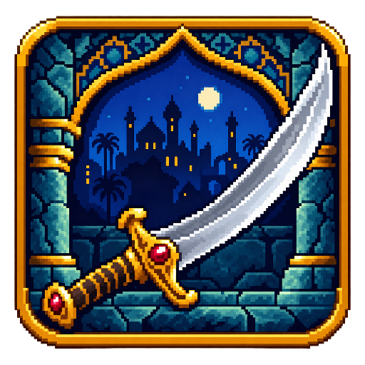
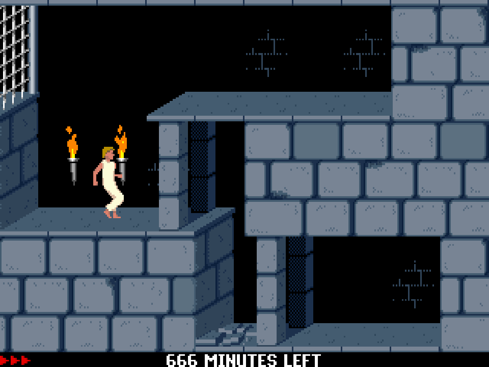
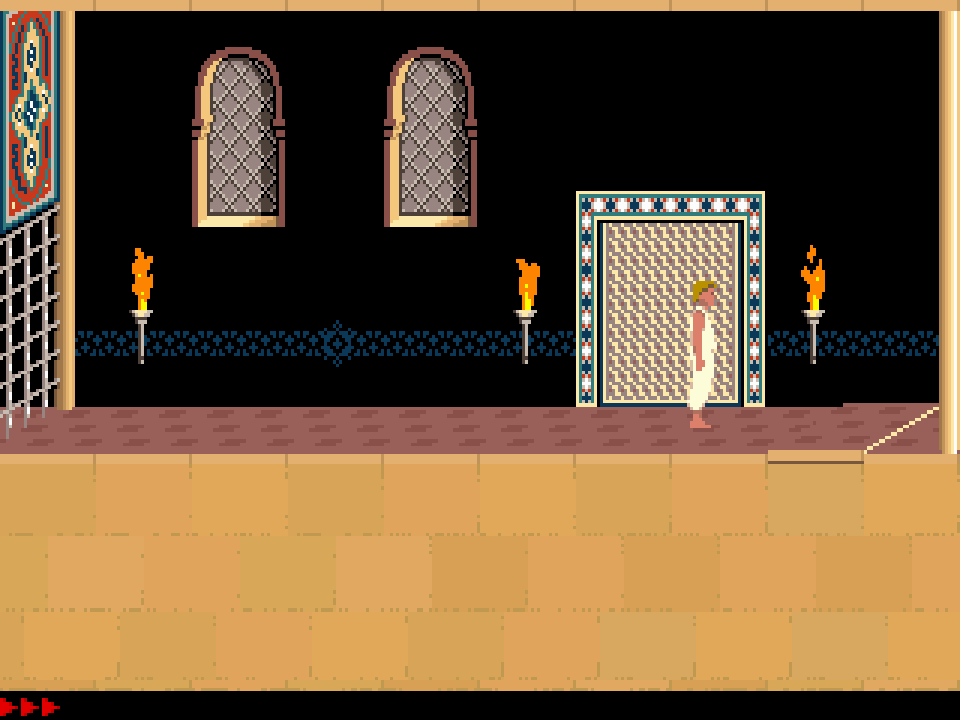

# PrinceGo



[Русский](README.ru.md)

Prince of Persia is a desktop Go port of the classic **Prince of Persia** platform adventure. Explore the dungeon and palace, jump over pits, climb ledges, avoid spikes and closing gates, collect potions, fight guards and rescue the princess.

## Screenshots

Actual screenshots of the running Go game.

**Dungeon**



**Palace**



## Requirements

- Go **1.25 or newer**. The first build needs network access to download Go modules; generating the Windows executable icon also downloads the resource tool.
- Windows x64; Linux x64/ARM64 with glibc; macOS 12 or newer on Intel/Apple Silicon.
- A working desktop graphics environment and audio device. Linux needs X11 or XWayland, OpenGL drivers and ALSA/PulseAudio system libraries.

## Build and run

Run the commands from the project root, where `main.go` and `go.mod` are located.

### Windows x64 — executable with icon

```powershell
$env:CGO_ENABLED = "0"
go generate .
go build -buildvcs=false -trimpath -ldflags="-s -w -H=windowsgui" -o Prince.exe .
.\Prince.exe
```

`go generate .` turns `icon.ico` into `icon_windows_amd64.syso`. Go automatically links that resource into the EXE, giving the file its Explorer icon. `-H=windowsgui` prevents a console window from opening. The generated `.syso` is a build artifact; it is not shipped in the source archive. Regenerate it after replacing `icon.ico`. After building, only `Prince.exe` is needed to run the game.

The resource tool is [rsrc](https://github.com/akavel/rsrc), pinned to v0.10.2 in the `go:generate` directive. A `go build` flag alone does not embed a Windows file icon; generate the resource first.

### Linux

```sh
CGO_ENABLED=0 go build -buildvcs=false -trimpath -ldflags="-s -w" -o Prince .
./Prince
```

The PNG icon is embedded automatically and used for the game window and, where supported by the desktop, its taskbar entry. ELF executables do not have a standard file-manager icon resource. An installed launcher can use `icon.png` in a `.desktop` entry; this is optional desktop integration, not a requirement for running the game.

### macOS — standalone executable

```sh
CGO_ENABLED=0 go build -buildvcs=false -trimpath -ldflags="-s -w" -o Prince .
./Prince
```

The same command builds for the architecture of the current Mac. A standalone executable is sufficient to play. For a Finder/Dock icon and double-click launch, create an optional `.app` bundle using `icon.icns`:

```sh
mkdir -p Prince.app/Contents/MacOS Prince.app/Contents/Resources
CGO_ENABLED=0 go build -trimpath -ldflags="-s -w" -o Prince.app/Contents/MacOS/Prince .
cp icon.icns Prince.app/Contents/Resources/icon.icns
cat > Prince.app/Contents/Info.plist <<'PLIST'
<?xml version="1.0" encoding="UTF-8"?>
<!DOCTYPE plist PUBLIC "-//Apple//DTD PLIST 1.0//EN" "http://www.apple.com/DTDs/PropertyList-1.0.dtd">
<plist version="1.0"><dict>
  <key>CFBundleName</key><string>Prince</string>
  <key>CFBundleDisplayName</key><string>Prince</string>
  <key>CFBundleIdentifier</key><string>org.Prince.game</string>
  <key>CFBundlePackageType</key><string>APPL</string>
  <key>CFBundleExecutable</key><string>Prince</string>
  <key>CFBundleIconFile</key><string>icon.icns</string>
  <key>CFBundleVersion</key><string>1.1.0</string>
  <key>CFBundleShortVersionString</key><string>1.1.0</string>
  <key>NSHighResolutionCapable</key><true/>
  <key>LSMinimumSystemVersion</key><string>12.0</string>
</dict></plist>
PLIST
open Prince.app
```

The `.app` is a macOS package containing the executable, icon and metadata. It is separate from the single-file distribution option. These commands create a local unsigned application; public distribution with Developer ID signing and notarization uses Apple's packaging tools.

### Cross-compilation

From a POSIX shell on Linux or macOS:

```sh
# Windows x64
# Run the generator on the host before setting GOOS/GOARCH.
go generate .
CGO_ENABLED=0 GOOS=windows GOARCH=amd64 go build -trimpath -ldflags="-s -w -H=windowsgui" -o Prince-windows-amd64.exe .

# Linux x64
CGO_ENABLED=0 GOOS=linux GOARCH=amd64 go build -trimpath -ldflags="-s -w" -o Prince-linux-amd64 .

# Linux ARM64
CGO_ENABLED=0 GOOS=linux GOARCH=arm64 go build -trimpath -ldflags="-s -w" -o Prince-linux-arm64 .

# macOS Apple Silicon
CGO_ENABLED=0 GOOS=darwin GOARCH=arm64 go build -trimpath -ldflags="-s -w" -o Prince-macos-arm64 .

# macOS Intel
CGO_ENABLED=0 GOOS=darwin GOARCH=amd64 go build -trimpath -ldflags="-s -w" -o Prince-macos-amd64 .
```

Choose the file for the target system and architecture. Cgo is disabled for every target. The Windows `.syso` filename restricts that resource to Windows amd64; it is ignored when building Linux or macOS. On PowerShell, set `GOOS`, `GOARCH` and `CGO_ENABLED` through `$env:` variables before `go build`; run `go generate .` with the host system selected so the resource generator can execute.

## Controls

| Key | Action |
| --- | --- |
| Left / Right | Move; turn when standing |
| Up | Jump; climb or pull up where possible; parry during sword combat |
| Down | Crouch; climb down or release a ledge; put the sword away during combat |
| Shift + direction | Take a careful step; hold a ledge while jumping or falling |
| Shift | Pick up the sword, drink a potion or perform a nearby action; strike during combat |
| Escape | Pause / resume |
| Ctrl+A | Restart the current level |
| Ctrl+R | Return to the beginning of the game |
| Ctrl+G | Save the game on levels 1–13 |
| Ctrl+L | Load the saved game from the title screen |
| Ctrl+S | Toggle sound |
| Ctrl+Q | Quit |
| Alt+Enter | Toggle fullscreen |

To obtain the sword on the first level, stand next to it and hold **Shift**. Take a careful step toward the sword if you are too far away. Supported gamepads can also provide gameplay input. Keyboard shortcuts use **Control**, including on macOS.

A normal save records the level, remaining time and health at the start of the level. Loading restarts that level; it does not restore an arbitrary position within a room.

## Saves and game data

The executable contains everything needed to start. On first launch it creates a user profile for saves, high scores and working copies of the embedded resources. No companion files are needed next to the executable.

| System | Default profile |
| --- | --- |
| Windows | `%APPDATA%\Prince` |
| Linux | `$XDG_CONFIG_HOME/Prince`, or `~/.config/Prince` |
| macOS | `~/Library/Application Support/Prince` |

Saves are stored as `dos14/PRINCE.SAV`, and high scores as `dos14/PRINCE.HOF`. To use another profile:

```sh
./Prince -profile /path/to/profile
```

On Windows:

```powershell
.\Prince.exe -profile C:\Games\PrinceProfile
```

Use a short profile path, up to 180 UTF-8 bytes. Separate profiles keep saves independent. Embedded game resources are restored when a working copy is missing or damaged.

## License and credits

Game engine source: **GPL-3.0-or-later**, see [LICENSE](LICENSE). Engine and dependency credits and their licenses are in [licenses](licenses), including [NOTICE.md](licenses/NOTICE.md). The original Prince of Persia graphics, levels and sound retain their original rights; the code license does not grant a separate license to those assets. Prince of Persia was created by Jordan Mechner and published by Brøderbund.
